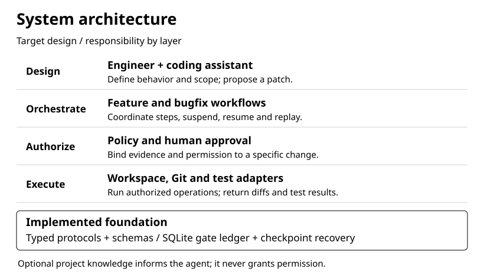

# Agentic Engineering Platform

English · [简体中文](README.zh-CN.md)

**A framework in development for teams that want AI to write code without letting it approve its own work.** Engineers define the expected behavior and acceptable risk. A coding agent proposes a change. The framework is being built to decide, from test results and explicit approvals, whether that change can move forward.

**Available in this checkout:** [typed models](src/agentic_engineering/core/models.py) for specs, artifacts, evidence and gate decisions; packaged [JSON Schemas](schemas/) for specs and evidence; and a [SQLite ledger](src/agentic_engineering/runtime/ledger.py) that restores the latest decision for a run after restart. It rejects a `GO` record that lists missing proof. It does **not** yet verify that proof is genuine, authorize writes or resume a complete coding workflow.

## What a gate is for

Suppose an agent changes a list screen to show an empty state. The empty-list test passes, but there is no result for a list **with** items. The proposed feature workflow would keep the change pending and report the missing regression check. A plausible explanation from the agent is not a test result.

| Planned workflow | What the engineer specifies | What a reviewer should receive |
| --- | --- | --- |
| Feature development | Observable behavior, acceptance cases and scope | Each requirement linked to the actual change and its verification |
| Bug repair | Original symptom, expected behavior and paths that must not change | Root-cause evidence, a check of the original failure and regression results |

The design separates model suggestions from permission to act. A recorded approval should apply to a particular change, not grant permanent write access. Offline replay is planned so contributors can inspect both an approved run and a correctly blocked one without credentials.

## System architecture

This is the target design. The outlined foundation section shows what exists today. The public core does not depend on project-specific integrations. Retrieved knowledge can suggest checks; it cannot satisfy them.



## How a task moves through the platform (planned)


## Development roadmap

| Milestone | Acceptance test |
| --- | --- |
| M1.1 · Human approval and resume **(next)** | Restart while patch A is awaiting approval: it must remain pending. Its approval can be consumed only once and cannot authorize patch B. |
| M1.2 · Permissions and offline replay | Deny unauthorized writes. Replay the same events without credentials or external side effects and reproduce the same decision. |
| M2 · Feature workflow | Demonstrate the list example three ways: pass the correct patch, block missing regression coverage, and block an out-of-scope edit. |
| M3 · Bugfix workflow | Show the original failure before the fix, a passing check afterward, and an unaffected control case. A high score cannot override missing evidence. |
| M4 · CLI and evaluation | A new contributor can run, inspect, resume and replay both an allowed and a blocked case. Report raw counts for incorrect decisions and human interventions. |
| M5 · Private extensions | Connect knowledge and tools through public interfaces without modifying the core or exposing private artifacts. |

## Try the current checkout

From the repository root, with Python 3.11+ and `uv`:

```sh
uv sync --locked --extra dev
uv run pytest -q
```

These tests check the repository contract, schema consistency and [cross-process gate recovery](tests/unit/core/test_checkpoint.py); they do **not** validate an AI-generated patch. For contribution checks see [Contributing](CONTRIBUTING.md). For what belongs in a project-specific integration rather than the public package, see [the public/private boundary](docs/architecture/public-private-boundary.md).

[Security](SECURITY.md) · [MIT license](LICENSE)
