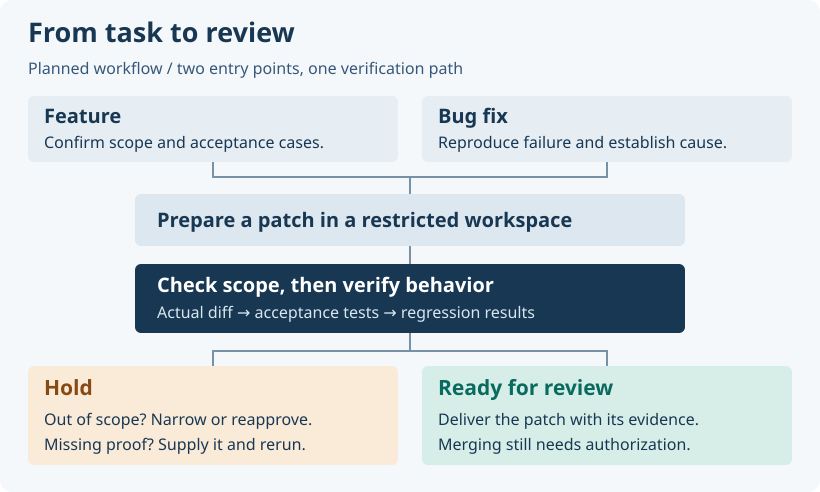

# Agentic Engineering Platform

English · [简体中文](README.zh-CN.md)

**A framework in development for teams that want AI to write code without letting it approve its own work.** Engineers define the expected behavior and acceptable risk. A coding agent proposes a change. The framework is being built to decide, from test results and explicit approvals, whether that change can move forward.

**Available in this checkout:** [typed models](src/agentic_engineering/core/models.py) for specs, artifacts, evidence and gate decisions; packaged [JSON Schemas](schemas/) for specs and evidence; and a [SQLite ledger](src/agentic_engineering/runtime/ledger.py) that restores the latest decision for a run after restart. It rejects a `GO` record that lists missing proof. It does **not** yet verify that proof is genuine, authorize writes or resume a complete coding workflow.

## Where the approach comes from

This platform turns the author's experience delivering features and fixing defects in `agent-hub` into reusable engineering standards for teams using AI. Its `story-gate` workflow traced requirements back to their sources and established an agreed feature baseline. Its `bugfix-gate` workflow checked root-cause evidence, audited the actual diff and verified that existing behavior still worked.

The design draws on OpenSpec for managing changes to specifications and on Superpowers for planning, test-driven development and verification. Engineers define expected behavior, acceptance cases and scope in a spec. The intended workflow takes that approved baseline through implementation and review, with each requirement linked to the change and its regression results.

For example, an engineer approves an empty-state message for a list. A later request adds a retry button. In the planned workflow, that interaction gets a revised spec, an acceptance case and a new scope approval. The earlier approval stays attached to the original baseline.

## What a gate is for

Suppose an agent changes a list screen to show an empty state. The empty-list test passes, but there is no result for a list **with** items. The proposed feature workflow would keep the change pending and report the missing regression check. A plausible explanation from the agent is not a test result.

| Planned workflow | What the engineer specifies | What a reviewer should receive |
| --- | --- | --- |
| Feature development | Observable behavior, acceptance cases and scope | Each requirement linked to the actual change and its verification |
| Bug repair | Original symptom, expected behavior and paths that must not change | Root-cause evidence, a check of the original failure and regression results |

The design separates model suggestions from permission to act. A recorded approval should apply to a particular change, not grant permanent write access. Offline replay is planned so contributors can inspect both an approved run and a correctly blocked one without credentials.

## System architecture

The diagram shows the target design. **OpenSpec is the single entry point for specifications**, acceptance scenarios, and implementation tasks. Agentic Engineering coordinates feature and bugfix workflows. After a human approves the spec revision and scope, a coding agent uses TDD in a sandbox to produce a candidate patch.

A restricted executor applies the patch with a one-time grant tied to its digest and spec revision. CI independently verifies the exact candidate commit. The delivery gate either sends the change to human review or pauses it. The bottom of the diagram shows the protocols and gate ledger available today. Project-specific tools connect to the public core through adapters.


## How a task moves through the platform (planned)



## Development roadmap

| Milestone | Acceptance test |
| --- | --- |
| M1.1 · Human approval and resume **(next)** | Recover the pending spec revision after restart. Adding a retry button requires approval of the revised scope. A patch execution grant applies to one version and can be consumed once. |
| M1.2 · Permissions and offline replay | Deny unauthorized writes. Replay the same events without credentials or external side effects and reproduce the same decision. |
| M2 · Feature workflow | Run the list example through OpenSpec. Send a correct patch to review, pause when regression evidence is missing, and block an out-of-scope edit. |
| M3 · Bugfix workflow | Show the original failure before the fix, a passing check afterward, and an unaffected control case. A high score cannot override missing evidence. |
| M4 · CLI and evaluation | A new contributor can run, inspect, resume and replay both an allowed and a blocked case. Report raw counts for incorrect decisions and human interventions. |
| M5 · Private extensions | Connect knowledge and tools through public interfaces without modifying the core or exposing private artifacts. |

## Try the current checkout

From the repository root, with Python 3.11+ and `uv`:

```sh
uv sync --locked --extra dev
uv run pytest -q
```

These tests check the repository contract, schema consistency and [cross-process gate recovery](tests/unit/core/test_checkpoint.py); they do **not** validate an AI-generated patch. For contribution checks see [Contributing](CONTRIBUTING.md). For what belongs in a project-specific integration rather than the public package, see [the public/private boundary](docs/architecture/public-private-boundary.md).

[Security](SECURITY.md) · [MIT license](LICENSE)
