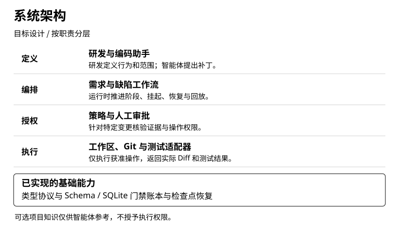
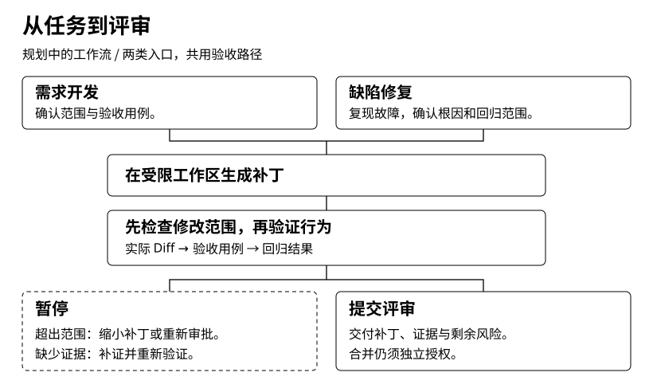

# Agentic Engineering Platform

[English](README.md) · 简体中文

**一个正在开发的 AI 编程框架：让 AI 写代码，但不让它给自己的改动放行。** 研发定义业务行为、验收标准和可接受的风险；编码智能体提出改动；框架的目标是根据实际测试结果和明确的人工授权，决定这次改动能否进入下一步。

**当前分支已实现：**需求规格、产物、证据和门禁决定的[类型模型](src/agentic_engineering/core/models.py)，随安装包交付的[规格与证据 JSON Schema](schemas/)，以及能在重启后恢复指定运行最新决定的 [SQLite 账本](src/agentic_engineering/runtime/ledger.py)。模型会拒绝「仍有证据缺失却标记 `GO`」的记录；它**还不能**核验证据真伪、授予写权限或恢复完整开发流程。

## 为什么需要门禁

假设 AI 为列表页加了空状态。空列表测试通过了，但没有验证**列表有数据时**是否仍正常显示。按规划中的需求流程，这次改动应停在待验证状态，并指出缺少哪项回归结果。AI 对代码的解释再合理，也不能代替这项测试。

| 规划中的流程 | 研发需要定义 | 评审者应该拿到 |
| --- | --- | --- |
| 需求开发 | 用户可观察的行为、验收场景、允许修改的范围 | 每条需求对应的实际改动和验证结果 |
| 缺陷修复 | 原始现象、预期行为、不能受影响的旧路径 | 根因证据、原问题验证和回归结果 |

设计上，模型可以提建议，但建议本身不是写权限。一次审批应只对特定改动生效。后续计划提供离线回放，让贡献者无需账号或密钥，也能检查一次放行为什么成立、另一次为什么被拒绝。

## 总体架构

下图是目标架构；底部绿色区域标出当前已实现的基础能力。公开核心不依赖项目专属集成。检索到的经验可以提示该测什么，不能替代测试证据。

[](docs/diagrams/architecture.zh-CN.svg)

## 开发任务如何流转（规划中）

[](docs/diagrams/workflow.zh-CN.svg)

## 开发路线与验收条件

| 里程碑 | 怎样才算完成 |
| --- | --- |
| M1.1 · 人工审批与恢复 **（下一步）** | 补丁 A 待审批时重启，恢复后仍须等待；批准只能消费一次，也不能用于补丁 B。 |
| M1.2 · 权限与离线回放 | 未授权不能写入；相同事件无需凭据、不产生外部副作用，也能重现相同决定。 |
| M2 · 需求开发工作流 | 用列表需求演示三种结果：正确补丁放行、缺回归测试被拒、计划外改动被拒。 |
| M3 · 缺陷修复工作流 | 证明修复前原路径失败、修复后通过、正常对照场景不变。高评分不能抵消关键证据缺失。 |
| M4 · CLI 与评估 | 新贡献者可运行、检查、恢复并回放放行和拒绝案例；评估报告提供误判与人工介入的原始计数。 |
| M5 · 私有扩展验证 | 通过公开接口接入知识库和工具，不修改通用核心，不暴露私有产物。 |

## 现在可以试什么

在仓库根目录执行，环境要求 Python 3.11+ 和 `uv`：

```sh
uv sync --locked --extra dev
uv run pytest -q
```

这些测试覆盖仓库契约、Schema 一致性和[跨进程恢复门禁决定](tests/unit/core/test_checkpoint.py)，**不是**验证 AI 生成的补丁。参与开发请看[贡献指南](CONTRIBUTING.md)；哪些集成应留在项目侧，请看[公开与私有内容边界](docs/architecture/public-private-boundary.md)。

[安全政策](SECURITY.md) · [MIT 许可证](LICENSE)
